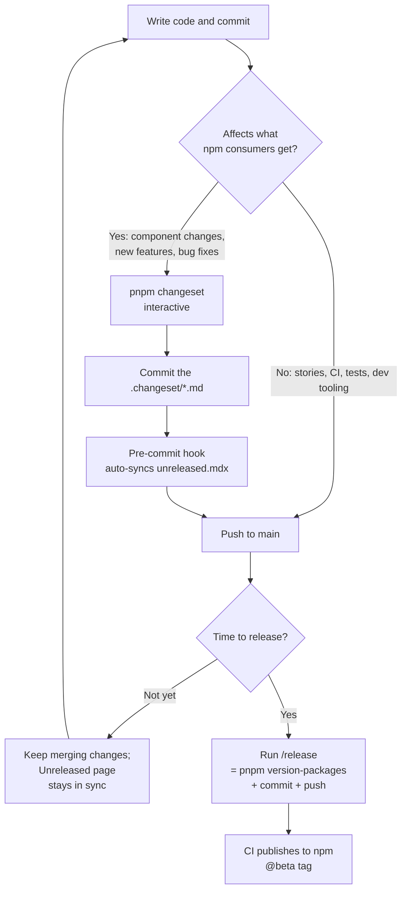

# Contributing to Keystone UI

This guide covers the end-to-end workflow for adding and maintaining components in Keystone UI.

## Quick Reference

| What | Where |
|------|-------|
| Component source | `packages/ui/src/{name}.tsx` |
| Package exports | `packages/ui/package.json` |
| Build entry points | `packages/ui/tsup.config.ts` |
| Registry metadata | `packages/ui/src/_registry.ts` |
| Storybook stories | `apps/storybook/stories/{name}.stories.tsx` |
| Fumadocs demos | `apps/docs/demos/{name}/` |
| Demo registry (generated) | `apps/docs/demos/manifest.json`, `apps/docs/demos/loader.tsx` |
| MDX documentation | `apps/docs/content/docs/components/{name}.mdx` |
| Component navigation | `apps/docs/content/docs/components/meta.json` |

## Adding a New Component

### 1. Scaffold

Run the scaffolding command from the workspace root:

```bash
pnpm add:component MyComponent
```

The scaffold creates the component, story, default demo and MDX page. It updates the package exports, tsup entry, `_registry.ts` and docs navigation. It regenerates `apps/docs/demos/manifest.json` and `apps/docs/demos/loader.tsx`. The new docs page and standalone preview return 404 until `pnpm gen:static-paths` refreshes `apps/docs/lib/static-paths.json`.

- `packages/ui/src/my-component.tsx` — component template
- `packages/ui/package.json` — subpath export
- `packages/ui/tsup.config.ts` — build entry
- `packages/ui/src/_registry.ts` — shadcn registry entry
- `apps/storybook/stories/my-component.stories.tsx` — story template
- `apps/docs/demos/my-component/default.tsx` — default demo
- `apps/docs/demos/manifest.json` and `apps/docs/demos/loader.tsx` — demo registry, regenerated with the new demo in it
- `apps/docs/content/docs/components/my-component.mdx` — documentation page
- `apps/docs/content/docs/components/meta.json` — navigation entry

### 2. Implement the component

Edit `packages/ui/src/my-component.tsx`. Follow the conventions in `.cursor/rules/component-architecture.mdc` and `.cursor/rules/design-tokens.mdc`.

Key rules:
- Single-file component (types, contexts, sub-components all in one file)
- Use `@base-ui/react` for primitives (never Radix UI)
- Use `class-variance-authority` for variants
- Add `data-slot` to every exported component part
- Use React 19 ref props (no `forwardRef`)

### 3. Write Storybook stories (primary development surface)

Edit `apps/storybook/stories/my-component.stories.tsx`. This is where you develop and iterate on the component visually.

Write comprehensive stories covering:
- All variants and sizes
- Interactive states (hover, focus, disabled, loading)
- Composition patterns
- Edge cases

Run Storybook: `pnpm dev --filter=@keystoneui/storybook`

### 4. Create Fumadocs demos

Create simplified demos in `apps/docs/demos/my-component/`. Not every Storybook story needs a demo — focus on the 3-6 most useful examples.

Each demo file must:
- Start with `"use client";`
- Import from `@keystoneui/react/my-component`
- Export a single default function

Example:

```tsx
"use client";

import { MyComponent } from "@keystoneui/react/my-component";

export default function MyComponentDefault() {
  return <MyComponent>Hello</MyComponent>;
}
```

### 5. Register demos

The demo registry is generated from the files under `apps/docs/demos/`, so a demo is registered by regenerating it, not by editing it:

```bash
pnpm gen:demos          # regenerate apps/docs/demos/manifest.json and loader.tsx
pnpm gen:static-paths   # regenerate apps/docs/lib/static-paths.json
```

After you run both generators for `MyComponent`, `apps/docs/lib/static-paths.json` contains `/docs/components/my-component` in `docs` and `my-component-default` in `preview`. `<ComponentPreview>` renders the demo inline. Open `/preview/my-component-default` to view it on its own.

The proxy checks only `/docs`, `/blog` and `/preview`. It returns 404 for an unknown page path or preview key under those prefixes. A docs page and its `.mdx` URL use the same entry. If you add a page later, run `pnpm gen:static-paths` again after writing its MDX.

A file at `apps/docs/demos/my-component/variants.tsx` gets the key `my-component-variants`, the name `<ComponentPreview>` takes. Never edit `manifest.json`, `loader.tsx` or `static-paths.json` by hand; `pnpm lint:docs` fails when any of them is stale.

### 6. Write MDX documentation

Edit `apps/docs/content/docs/components/my-component.mdx`, following `apps/docs/content/docs/components/_template.mdx`. Keep its section order: frontmatter, `<ComponentPreview name="my-component-default" />`, `## Installation`, `## Usage` (with the import line), `## Composition` for a compound component, `## Examples` with one `###` heading per variant preview, the optional `## RTL`, then `## API Reference`. `pnpm lint:docs` fails the page when `## Installation`, `## Usage` or `## API Reference` is missing, a compound component lacks `## Composition`, or a variant preview sits under its own `##` heading instead of a `###` heading in `## Examples`.

Write the prose by `apps/docs/WRITING.md`: one content type per page, sentence-case headings, no banned words or em dashes. `pnpm lint:docs` runs the prose lint (`scripts/lint-docs-prose.mjs`) over every page.

### 7. LLMs.txt (automatic)

No manual step. The LLMs.txt pipeline reads MDX pages and replaces `<ComponentPreview>` tags with actual demo source code. After deployment, the endpoints at `/llms.txt`, `/llms-full.txt`, `/llms-components.txt`, and `/docs/components/my-component.mdx` are updated automatically.

### 8. Stories ↔ demos parity (lint)

Stories and demos are intentionally separate surfaces — stories are the dev sandbox + interaction test bed; demos are the docs render + registry-installable source. They enumerate variants differently (stories per-variant, demos sometimes consolidate). When you add a new story or demo variant, run `pnpm lint:stories-demos`. If it flags the new variant as story-only or demo-only:

- If the divergence is intentional (per-variant `Secondary`/`Destructive` story vs consolidated `variants.tsx` demo, dev-only fixture like `CryptoTransactions`, etc.), add it to `scripts/stories-demos-allowlist.json` with a one-line rationale.
- Otherwise, author the missing counterpart on the other surface.

The lint is also wired into `pnpm lint:docs` so CI catches drift on every PR.

## Adding a New Block

Blocks are full-page or feature-level compositions (sign-in pages, data tables, etc.). Unlike components, there is no `pnpm add:block` scaffolder yet — block items in `registry.json` are hand-maintained. Brief workflow:

1. Write the demo at `apps/docs/demos/blocks/<name>.tsx` or `apps/docs/demos/blocks/<name>/index.tsx`. For a single file, use a top-level function declaration for the component. End the demo with a named `export default function` that renders it. A directory block exports its demo as the default from `index.tsx`.
2. Run `pnpm gen:demos`. Both layouts use the key `block-<name>`.
3. Add a `registry:block` item named `<name>` to `registry.json`.
   - Include at least one category in `categories`. Examples include `authentication`, `login`, `signup`, `navigation`, `data` and `betting`. Use a single lowercase word for a new category. `pnpm registry:sync` warns if categories are missing.
   - List component files as `registry:component`. A single-file block needs exactly one component `path`.
   - For a directory block's generated components, use `registry/default/blocks/<name>/components/` and the original sibling filenames. `index.tsx` is the preview entry.
   - If the block installs a page, declare a `registry:page` file with a source `path` and a `target` such as `app/<slug>/page.tsx`.
4. For each `registry:page` entry, write the page by hand at its `path`, such as `registry/default/blocks/<name>/page.tsx`. The entry's `target` is the install location in the consumer's app. Have the page import and render the installed component.
5. Run `pnpm sync:blocks` to generate the installable components.
6. Write `apps/docs/content/docs/blocks/<name>.mdx` using `apps/docs/content/docs/blocks/_block-template.mdx`. Include the install command in a bash fence, `<BlockPreview name="block-<name>" />` and links to the primitives under `## Components Used`.
7. Run `pnpm gen:static-paths`. In `apps/docs/lib/static-paths.json`, the MDX filename supplies `/docs/blocks/<name>` in `docs`. The demo manifest supplies `block-<name>` in `preview`. The docs entry can exist before the preview key. `<BlockPreview>` embeds `/preview/block-<name>` in an iframe.
8. Run `pnpm docs:backlinks` to update `## Related Blocks` on the linked component pages.
9. Add the block to the Block Selection table in `skills/keystoneui-react/SKILL.md`.

Run `pnpm registry:build` to refresh the installable items in `apps/docs/public/r/`.

See `.claude/skills/contributing/SKILL.md` → "Adding a New Block" for the full per-step checklist and the current category taxonomy.

## Writing guides and concept pages

Pages outside `components/` and `blocks/` follow the [Diátaxis](https://diataxis.fr) types in `apps/docs/WRITING.md`. Start from the matching template in `apps/docs/content/docs/` (`_tutorial-template.mdx`, `_how-to-template.mdx`, `_concept-template.mdx`) and put the page in the folder for its type. Moved pages are not redirected: when you move a page, update every link to its old URL in the same change and run `pnpm gen:static-paths`. `apps/docs/tests/docs-links.test.ts` fails on any link to a docs page that does not exist.

## Updating an Existing Component

### When to update Fumadocs

| Change type | Storybook | Demos | MDX |
|-------------|-----------|-------|-----|
| **New prop or variant** | Add/update story | Add demo if user-facing | Update API Reference table |
| **Prop renamed or removed** | Update stories | Update affected demos | Update API Reference table |
| **New sub-component** | Add stories | Add demo if no existing demo shows it | Update the page's import block AND the Composition tree |
| **Visual/styling change** | Auto-reflects | Auto-reflects | No change needed |
| **Bug fix** | Add regression story | No change needed | No change needed |
| **Description change** | N/A | N/A | Update MDX frontmatter |

### Checklist for API changes

1. Update the component source in `packages/ui/src/{name}.tsx`
2. Update or add Storybook stories
3. If the change is user-facing:
   - Update relevant demos in `apps/docs/demos/{name}/`
   - Add a demo for a new feature that no existing demo shows
   - Update the MDX API Reference table
4. If dependencies changed, update `packages/ui/src/_registry.ts`

### Checklist for new sub-components

1. Update the component source
2. Add Storybook stories for the new sub-component
3. If no existing demo shows the sub-component, create one showing it in use
4. If you created a demo, run `pnpm gen:demos`, then `pnpm gen:static-paths`.
5. Update the page's import block (at the top of `## Usage`), and add a `<ComponentPreview>` under a `###` heading in `## Examples` for any new demo
6. Update the `## Composition` ASCII tree in the MDX so agents see the new nesting

### Composition section (compound components)

For compound components (≥2 exported parts that nest), include a `## Composition` section after `## Usage` with an ASCII tree of the parts. The tree mirrors what shadcn/ui ships and helps both human readers and LLMs see required nesting at a glance — the section flows through `llms-full.txt` automatically. Use box-drawing characters (`├──`, `└──`, `│`) and indent two spaces per level. Skip for single-piece components (Button, Badge, Input, Spinner, etc.).

## Development Commands

```bash
pnpm dev --filter=@keystoneui/storybook    # Storybook dev server (port 6006)
pnpm dev --filter=@keystoneui/docs          # Fumadocs dev server (port 3000)
pnpm build --filter=@keystoneui/docs        # Build docs (verifies types + LLMs.txt)
pnpm add:component <Name>       # Scaffold a new component
```

## Release Workflow

The library uses [Changesets](https://github.com/changesets/changesets) in **pre-release mode** to publish beta versions to npm. The package is published as `@keystoneui/react` and consumers install with `pnpm add @keystoneui/react@beta`. Inside Claude Code, the `/release` skill wraps the entire local-side flow (bump → sync → commit → push).

### Two changelogs, one source of truth

Two changelogs are surfaced to consumers, and both flow from `.changeset/*.md`:

| Surface | Path | Generated by | Hand-edit? |
|---------|------|--------------|------------|
| npm changelog | `packages/ui/CHANGELOG.md` | `changeset version` | No — derived from `.changeset/*.md` |
| Docs site changelog | `apps/docs/content/changelog/<date>-v<ver>.mdx` (released) and `unreleased.mdx` (queued) | `scripts/sync-unreleased.mjs` | Optional — auto-generated, polish post-rotation if you want richer formatting |

`unreleased.mdx` is **automatically regenerated** from the unconsumed `.changeset/*.md` files by:
1. The `pre-commit` hook — every time you commit a new or modified `.changeset/*.md`, the hook runs `pnpm sync-unreleased` and stages the result.
2. `pnpm version-packages` — runs sync first so the dated mdx (after rotation) inherits real auto-derived content.

If you want to hand-curate the Unreleased section for a specific release (e.g. add `<ChangeTag>` / `<ComponentPreview>` decoration), stage your `unreleased.mdx` edit alongside the changeset — the pre-commit hook detects this and skips the auto-sync to preserve your edit.

To regenerate manually: `pnpm sync-unreleased`.

### How it works



### When you need a changeset

Create a changeset for any change that affects what consumers of `@keystoneui/react` (or `@keystoneui/mcp`) receive:

- New component or MCP tool
- Bug fix in a component
- Changed API, props, or behavior
- Styling changes that affect consumers
- Updated dependencies in `packages/ui/package.json` or `packages/keystoneui-mcp/package.json`

### When you do NOT need a changeset

Skip the changeset for anything internal to the repo:

- Storybook stories
- CI workflow changes
- Documentation (docs app, README)
- Test additions or fixes
- Dev tooling changes

Commits without a changeset push to GitHub but do not trigger an npm publish. The `@beta` tag on npm stays at the previous version until you explicitly release.

### Day-to-day flow

```bash
# 1. Make a change, commit it
git add packages/ui/src/foo.tsx
git commit -m "fix(ui): correct foo focus ring"

# 2. Add a changeset (interactive: pick package, bump type, summary)
pnpm changeset

# 3. Commit the changeset — pre-commit hook auto-syncs unreleased.mdx
git add .changeset/
git commit -m "chore: changeset for foo fix"

# 4. Push when ready
git push origin main
```

You can batch many of these. The Unreleased docs section accumulates queued work as you commit changesets — by release time, it already shows what's coming.

### Releasing

When the queued work is ready to ship, invoke `/release` (in Claude Code) or run the equivalent commands:

```bash
# 1. Bump (wraps sync-unreleased + changeset version + rotate-changelog)
pnpm version-packages

# 2. Sanity-build the docs (Zod-validates the new mdx frontmatter)
pnpm build --filter=@keystoneui/docs

# 3. Stage the version-bump artifacts only
git add \
  packages/ui/package.json \
  packages/ui/CHANGELOG.md \
  packages/keystoneui-mcp/package.json \
  packages/keystoneui-mcp/CHANGELOG.md \
  apps/docs/content/changelog/ \
  .changeset/

# 4. Commit and push
git commit -m "chore: version packages"
git push origin main
```

CI runs `.github/workflows/release.yml` on push to `main`. While unconsumed changesets exist, `changesets/action@v2` opens (or updates) a **Version Packages** PR that runs `pnpm version-packages`; merging that PR is the alternative to `/release`. Once the bumped versions are on `main`, the same workflow publishes anything not yet on npm via `pnpm release` using npm **Trusted Publishing** (OIDC — there is no `NPM_TOKEN`), then creates a GitHub Release per package from the matching `CHANGELOG.md` section. Idempotent — re-running on a no-op push does nothing.

### Dist-tags: releases need no manual step

`changeset publish` sets only one dist-tag per package, and picks differently for each: `@keystoneui/react` lands on `beta`, while `@keystoneui/mcp` (which has only ever published prereleases) lands on `latest`. It refuses a custom `--tag` in pre mode, and a Trusted Publishing credential can't move tags afterwards (`E403 … This trusted publisher cannot manage dist-tags`).

So the docs install from the tag CI does move: every install command says `@keystoneui/react@beta`, and the MCP server runs via `npx @keystoneui/mcp@latest`. `apps/docs/tests/install-dist-tag.test.ts` enforces this while in pre mode — and requires `@beta` to be dropped once you exit it.

Optional: the other tag (react's `latest`, mcp's `beta`) stays on an older version unless you move it. The Release run lists the commands in its job summary; run them with your own npm login:

```bash
npm dist-tag add @keystoneui/react@<version> latest
npm dist-tag add @keystoneui/react@<version> beta
npm dist-tag add @keystoneui/mcp@<version> latest
npm dist-tag add @keystoneui/mcp@<version> beta
```

Each command is a no-op when the tag already points there. Verify with `npm view @keystoneui/react dist-tags`.

### Version progression

In pre-release mode, each publish increments the beta counter regardless of declared bump type:

| Cycle | Version |
|-------|---------|
| Initial | `0.1.0-beta.0` |
| After 1st bump | `0.1.0-beta.1` |
| After 2nd bump | `0.1.0-beta.2` |
| Major-bump changeset | resets to `1.0.0-beta.N` |

The bump type (patch, minor, major) is remembered by changesets and applied when you exit beta.

### Exiting beta (stable release)

When the library is ready for a stable release:

```bash
pnpm changeset pre exit     # exit pre-release mode
pnpm changeset              # create a changeset for the stable release
pnpm version-packages       # bumps to stable version (e.g. 1.0.0)
git add . && git commit -m "chore: release stable version"
git push origin main        # publishes to @latest tag
# then drop `@beta` from every install command in the docs --
# apps/docs/tests/install-dist-tag.test.ts fails until you do
```

After this, `pnpm add @keystoneui/react` (without `@beta`) installs the stable version.

## LLMs.txt Endpoints

These are generated automatically from MDX + demo files:

| URL | Description |
|-----|-------------|
| `/llms.txt` | Index of all documentation pages |
| `/llms-full.txt` | Complete documentation content |
| `/llms-components.txt` | Component documentation only |
| `/docs/components/{name}.mdx` | Individual component page |

The pipeline replaces `<ComponentPreview name="X" />` tags with actual demo source code from disk, so AI agents receive real, executable code examples.
